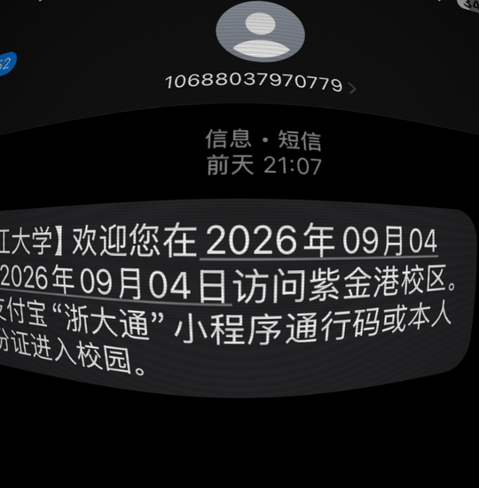

# 鱼眼畸变效果（Fisheye + 摩尔纹 + 暗角）

屏摄风格效果：桶形鱼眼畸变、细扫描线/摩尔纹干涉、四周暗角，附带聚焦推镜 + 标注滑入的 Remotion 动画项目。



## 目录结构

- 仓库根目录：Vite + React 交互测试应用（拖图/点击移动聚焦/导出 PNG）
- `src/lib/`：核心模块（`FisheyeRenderer.js` 与框架无关，`FisheyeView.jsx` React 封装）
- `vibe-motion-app/`：Remotion 项目，把鱼眼效果做成视频（聚焦推镜 + 黄色标注滑入）

## 运行

```bash
npm install
npm run dev
```

打开后默认加载 `public/test.jpg`。可拖入或选择任意图片/视频文件；在画面上点击/拖动即可移动聚焦（畸变中心）位置；「导出 PNG」保存当前效果帧。

## 模块

### `src/lib/FisheyeView.jsx` — React 组件

```jsx
import FisheyeView from './lib/FisheyeView.jsx';

<FisheyeView
  source={imgOrVideoElement}   // 已加载的  / <video> 元素
  strength={1.6}               // 畸变强度（0 = 无畸变）
  zoom={1.35}                  // 中心缩放
  focus={{ x: 0.5, y: 0.5 }}   // 聚焦位置，0..1，页面坐标（y 向下）
  moire={{ intensity: 0.28, scale: 900, angle: 0 }}
  vignette={{ amount: 0.85, radius: 0.72, softness: 0.45 }}
  rects={[]}                   // 标注矩形，默认不加；见下
  onFocusChange={(f) => ...}   // 传入后画面可点击/拖动改变聚焦位置
/>
```

#### 标注矩形 `rects`

在源图坐标上画色块标注，随鱼眼一起弯曲，并被摩尔纹/暗角覆盖，看起来像原图上就有的高亮。默认 `[]` 不加，最多 8 个：

```js
rects={[{
  x: 0.27, y: 0.57, w: 0.08, h: 0.05, // 源图 0..1 坐标（y 向下）
  color: '#ffd900',
  opacity: 0.9,
  blend: 'screen', // 'normal' | 'multiply' | 'screen' | 'lighten'
  mask: 1,         // 0..1 从左到右滑入进度（动画用），默认 1 全显示
}]}
```

做滑入动画时逐帧把 `mask` 从 0 推到 1 即可（测试应用里的「播放滑入动画」按钮就是 600ms ease-out 的示例）。

混合模式选择：深色底图 + 白字用 `screen`（暗部提成黄色、白字保持可读）；浅色底图 + 深字用 `multiply`（像荧光笔，白底变黄、黑字不变）。

### `src/lib/FisheyeRenderer.js` — 与框架无关的 WebGL 渲染器

```js
const r = new FisheyeRenderer(canvas);
r.setSource(imageOrVideo);   // 视频会自动按 rAF 逐帧渲染
r.setParams({ strength: 2, focus: { x: 0.3, y: 0.4 } });
r.destroy();
```

## Remotion 视频项目 `vibe-motion-app/`

复用同一个 `FisheyeRenderer`，按帧独立计算动画量（Remotion 会并行/乱序渲染帧）：

```bash
cd vibe-motion-app
pnpm install          # postinstall 会准备 headless 浏览器
pnpm run dev          # Remotion Studio 预览
pnpm run remotion:render   # 渲染，默认 prores 4444 透明 mov
# 渲染 mp4：
REMOTION_OUTPUT=out/fisheye.mp4 REMOTION_CODEC=h264 REMOTION_PIXEL_FORMAT=yuv420p pnpm run remotion:render
```

动画参数在 `vibe-motion-app/motion/config.js`（聚焦起止点、zoom、时间轴、标注矩形、摩尔纹/暗角），逐帧计算在 `motion/timeline.js`。渲染用 WebGL，headless 浏览器需 `--gl angle`（脚本已默认）。

## 效果实现说明

- **鱼眼畸变**：以 `focus` 为中心的桶形畸变 `p' = p·(1 + strength·r²) / zoom`，按画布宽高比校正，保证畸变呈圆形。
- **摩尔纹**：跟随画面弯曲的细扫描线，与固定屏幕扫描线（频率略有偏差）相乘产生干涉拍纹，两者混合。
- **暗角**：以画面中心的径向 `smoothstep` 压暗，半径与柔和度可调。
